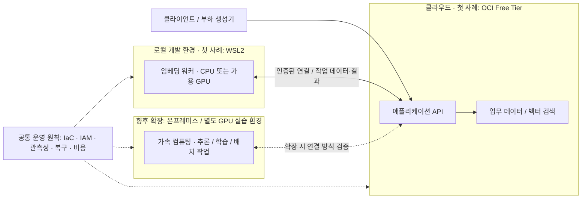

# AI Platform PE Core

**클라우드와 온프레미스를 아우르는 하이브리드 AI 플랫폼의 설계·구축·운영 역량을 쌓는 학습 및 아키텍처 검증 프로젝트.**

NVIDIA의 **AI Infrastructure and Operations 인증 체계**를 중심으로 기반 지식을 체계화하고, 재현 가능한 샌드박스 실험으로 설계 판단을 검증합니다. 컴퓨터시스템응용기술사의 시선으로 CPU·GPU, 메모리, 스토리지, 네트워크의 물리적 제약을 이해하고 이를 워크로드 배치와 운영 정책으로 연결합니다.

현대적 아키텍처를 실습할 첫 환경으로 **클라우드**를 선택했으며, 그중 **OCI Free Tier**를 강의 비용과 접근성을 고려한 첫 샌드박스 사례로 다룹니다. 장기적인 학습 범위는 클라우드, 로컬 개발 환경, 온프레미스 GPU 인프라를 연결하는 하이브리드 플랫폼입니다.

> **현재 상태: 기획 단계.** 아래 구성과 로드맵은 구현 계획입니다. 배포 코드, GPU 환경, 벤치마크 및 검증 결과는 아직 없습니다. 인증 취득이나 실무 역량 검증을 완료했다는 의미도 아닙니다.

## 학습의 기준: AI Infrastructure and Operations

학습의 출발점은 [NVIDIA-Certified Associate: AI Infrastructure and Operations (NCA-AIIO)](https://www.nvidia.com/en-us/learn/certification/ai-infrastructure-operations-associate/)입니다. 공식 범위인 AI 기초, AI 인프라, AI 운영을 바탕으로 학습하고, 실제 구축·운영 경험에 따라 [NCP-AII 및 NCP-AIO](https://www.nvidia.com/en-us/learn/certification/) 심화 학습으로 확장합니다.

아래는 공식 시험 영역을 참고해 구성한 **이 프로젝트의 실습 계획**이며, 시험 범위 전체를 대체하는 커리큘럼은 아닙니다.

| 학습 축 | 프로젝트에서 다룰 질문과 산출물 |
| --- | --- |
| AI 및 가속 컴퓨팅 기초 | 학습·추론·임베딩·검색의 자원 특성, CPU/GPU 역할과 소프트웨어 스택 정리 |
| 컴퓨팅·스토리지·네트워크 | 메모리 용량·대역폭, I/O, 데이터 이동과 가속 인프라의 병목 분석 |
| 인프라 배치 | 클라우드·온프레미스 선택 근거, GPU 확장, 전력·냉각 및 시설 요구사항 비교 |
| AI 운영 | 모니터링, GPU 관측, 오케스트레이션·작업 스케줄링, 가상화와 자원 격리 실험 |
| 플랫폼 엔지니어링 적용 | IaC, 접근 제어, 배포 재현성, 장애 복구, 서비스 수준과 비용 관리 |

NVIDIA 기술을 깊이 학습하면서도 각 선택을 성능, 운영 복잡성, 데이터 위치, 비용 및 이식성 관점에서 설명합니다. 인증 학습과 실습 결과는 별도로 기록하고, 학습한 개념을 실제 환경에서 어디까지 검증했는지 표시합니다.

## 하이브리드 플랫폼 관점

워크로드별 요구사항에 따라 실행 위치를 결정합니다. 모든 구성요소를 클라우드에 두거나 모든 연산을 온프레미스로 옮기는 것을 전제로 하지 않습니다.

이 그림은 목표 배치의 개념도입니다. 로컬 WSL2는 초기 워커 실습 환경이며, 데이터센터나 GPU 클러스터의 대체 검증 환경으로 간주하지 않습니다. GPU 보유·사용 가능 여부는 아직 전제하지 않습니다.

하이브리드 설계에서는 다음 경계를 명시합니다.

- **연산과 데이터:** 데이터 위치, 전송량·비용, 네트워크 지연, 모델·임베딩 버전과 데이터 신선도
- **보안과 연결:** 서비스 인증, 최소 권한, 비밀정보 관리, 암호화 및 접근 경로
- **장애와 복구:** 연결 단절, 워커 중단, 재시도·중복 처리, 백업과 복구 목표
- **운영 책임:** 직접 운영할 영역과 관리형 서비스에 맡길 영역, 관측 가능한 지표와 통제 범위

구체적인 제품·프로토콜·배치 구조는 실험 명세에서 결정합니다. 공통 운영 원칙을 적용하되 환경별 IaC와 운영 절차의 차이도 기록합니다.

## 첫 샌드박스: OCI Free Tier + 로컬 워커

첫 사례는 발표 **「하드웨어를 지배하는 아키텍트」**와 연결되는 **OLTP와 AI 워크로드의 공존**입니다. 적은 비용으로 강의와 반복 실습을 진행하고, 제한된 CPU·메모리·I/O 예산에서 통합과 격리의 트레이드오프를 드러냅니다.

[OCI Free Tier](https://www.oracle.com/cloud/free/)의 Always Free 범위를 우선 검토하고, 기간 한정 Trial 크레딧과 구분합니다. 실제 서비스 가용성, 할당량, 리전 용량 및 과금 조건은 배포 전에 확인합니다. 이 샌드박스는 무료 GPU나 전체 AI 인프라 학습 환경을 제공한다고 가정하지 않습니다.

| 구성 후보 | 첫 실습에서의 역할 | 구현 전 확인 사항 |
| --- | --- | --- |
| OCI 애플리케이션 환경 | OLTP·검색 API와 워커 연계 | 자원 예산, 동시성, 연결 경로와 배포 방식 |
| Oracle 26ai | 업무 데이터와 벡터의 논리적 통합 사례 | 배포 형태, 기능·라이선스, 무료 범위 적합성, DB 내부 경합 |
| 로컬 WSL2 워커 | 임베딩 생성 오프로딩 | CPU/GPU 가용성, 배치 크기, 재시도, 결과 반영 지연 |
| Terraform | OCI 인프라 형상 관리 | 생성·변경·삭제 재현성, 상태 및 비밀정보 관리 |

애플리케이션·데이터·임베딩 연산을 역할별로 나누고 실행 환경의 분리 효과를 검증합니다. **논리적 계층 분리만으로 완전한 물리적 격리가 성립하지는 않습니다.** 또한 임베딩 생성을 로컬로 옮겨도 DB 안에서 실행되는 Vector Search와 OLTP의 자원 경합은 남을 수 있습니다.

Oracle의 Converged Database는 통합형 데이터 계층의 첫 비교 사례입니다. CDC·Kafka 등 별도 파이프라인을 줄일 수 있는 범위와, 여전히 필요한 데이터 갱신·실패 복구 절차를 함께 평가합니다. 통합형 또는 분리형 구성을 선택하는 기준은 SLA, 데이터 신선도, 운영 부담과 비용입니다.

## 실험과 검증

각 실험 전에 데이터셋, 자원 사양, 비교 조건, SLA/SLO 및 허용 성능 저하 범위를 정합니다. 측정 결과에는 쿼리, 동시성, 워밍업, 반복 횟수와 환경별 차이를 남깁니다.

| 단계 | 검증 내용 | 주요 지표 / 근거 |
| --- | --- | --- |
| 첫 샌드박스 | OLTP 단독 → 검색 병행 → 임베딩 갱신 병행 | p50/p95/p99 지연, 처리량, 오류율, CPU·메모리·I/O |
| 격리 비교 | 오프로딩·동시성 제어 전후의 효과와 잔여 경합 | OLTP 성능 저하, 검색 지연, 워커 적체와 데이터 신선도 |
| 하이브리드 운영 | 네트워크 지연·단절 및 워커 재시작 | 재시도·중복 처리 결과, 복구 시간, 전송량과 비용 |
| GPU 실습 확장 | 가속 워크로드 배치·스케줄링·관측 | GPU 사용률·메모리, 처리량·지연, 장애 진단 기록 |
| 운영 모델 비교 | 온프레미스·클라우드·관리형 서비스 선택 | SLA 충족 여부, 운영 책임, 복구 가능성, 비용과 이식성 |

CPU 캐시 미스, 메모리 대역폭 등은 관측 가능한 환경에서 분석합니다. 가상화 또는 관리형 서비스로 인해 접근할 수 없는 지표는 추론과 구분합니다.

**실습 범위의 경계:** 초기 OCI·WSL2 실습으로는 멀티 GPU 확장, 고속 인터커넥트, 데이터센터 전력·냉각 및 대규모 클러스터 운영을 입증할 수 없습니다. 해당 영역은 공식 자료 기반 설계 학습과 별도 장비·접근 권한이 확보된 실습으로 확장하고, 설계 검토와 실측 결과를 구별합니다.

## 단계별 로드맵

1. **기반 학습과 실험 명세:** NCA-AIIO 공식 학습 범위를 정리하고 워크로드·SLA·자원 예산 및 배치 판단 기준 정의
2. **강의용 클라우드 사례:** OCI Free Tier 가용성 확인, Terraform 구성, OLTP·검색 API와 WSL2 임베딩 워커 구현
3. **하이브리드 운영 검증:** 자원 경합, 네트워크 장애, 접근 제어, 관측성 및 복구 절차 실험
4. **NVIDIA 가속 인프라 실습:** 가용 장비와 예산에 맞춰 GPU 환경을 확보하고 구축·운영 실습 및 NCP-AII/NCP-AIO 심화 학습 확장
5. **플랫폼 운영 모델 비교:** 자체 운영, 클라우드 관리형 서비스, 혼합 운영의 성능·비용·책임 범위 평가
6. **재사용 가능한 학습 산출물:** 배포 코드, 실험 명세, 벤치마크, 운영 가이드와 아키텍처 결정 기록 축적

Enterprise Managed Service는 요구사항에 따라 선택할 수 있는 진화 경로 중 하나입니다. 최종 배치는 실험 결과와 운영 역량에 따라 결정합니다. 현재 실행 명령은 제공하지 않으며, 구현 시 재현 가능한 배포·실험·정리 절차를 함께 추가합니다.

## 발표와의 연결

| 발표 구간 | 이 저장소에서 준비할 근거 |
| --- | --- |
| 1–3장 · 하드웨어를 지배하는 아키텍트 | CPU·GPU 및 메모리·I/O 제약과 워크로드 특성 |
| 4–7장 · 기술적 딜레마와 트레이드오프 | 통합·격리 비교, 데이터 파이프라인의 운영 비용, PoC 명세 |
| 8–12장 · OCI Free Tier 설계 사례 | 강의용 자원 예산, Oracle 26ai 통합 사례, WSL2 오프로딩, Terraform |
| 13–15장 · 플랫폼 엔지니어의 길 | SLA 검증, 하이브리드 배치 판단, NVIDIA 기반 역량 확장과 운영 모델 선택 |

발표의 OCI 사례를 출발점으로, **하드웨어를 이해하고 환경을 넘나들며 설계·구축·운영을 근거로 설명하는 AI 플랫폼 엔지니어**로 성장하는 과정을 기록합니다.

## 공식 참고 자료

- [NVIDIA NCA-AIIO: 학습 및 시험 범위](https://www.nvidia.com/en-us/learn/certification/ai-infrastructure-operations-associate/)
- [NVIDIA Certification: Associate / Professional 인증 체계](https://www.nvidia.com/en-us/learn/certification/)
- [Oracle Cloud Free Tier: Always Free와 Trial 안내](https://www.oracle.com/cloud/free/)

인증 범위와 클라우드 제공 조건은 변경될 수 있으므로 학습·실습 시점의 공식 문서를 기준으로 확인합니다.
