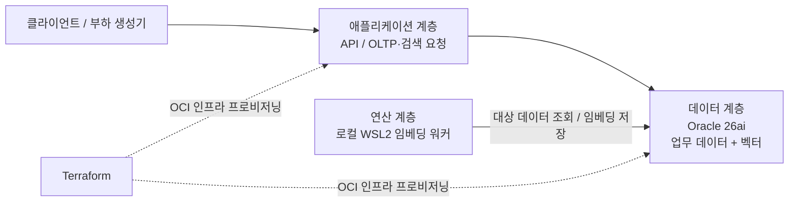

# AI Platform PE Core

**제약된 자원에서 AI와 OLTP의 공존을 설계하고 검증하는 플랫폼 엔지니어링 샌드박스.**

발표 **「하드웨어를 지배하는 아키텍트」**의 설계를 실제 실험으로 이어가는 저장소입니다. 컴퓨터시스템응용기술사의 시선으로 CPU 캐시, 메모리 대역폭, I/O 병목을 살펴보고, AI 워크로드가 OLTP의 응답 시간과 처리량에 미치는 영향을 측정합니다.

> **현재 상태: 프로젝트 기획 단계.** 이 README는 앞으로 구현할 샌드박스의 목적과 검증 계획입니다. 인프라, 애플리케이션, 벤치마크 및 검증 결과는 아직 포함되어 있지 않습니다.

## 핵심 질문

**데이터는 논리적으로 통합하면서, 무거운 연산은 물리적으로 분리하여 OLTP SLA를 지킬 수 있는가?**

- Vector Search와 임베딩 생성은 각각 어떤 자원을 소비하며, OLTP와 어디서 경합하는가?
- 통합형 데이터베이스로 CDC·Kafka 등 별도 데이터 파이프라인의 필요성을 얼마나 줄일 수 있는가?
- 파이프라인 단순화로 얻는 이점과 데이터베이스 내부 자원 경합 사이의 타협점은 무엇인가?
- 제한된 인프라에서 어떤 격리가 가능하며, 어떤 경합은 남는가?

발표의 **Level 1(통합)과 Level 3(격리)** 비교를 출발점으로 삼되, 각 실험에서는 배치 구조와 자원 공유 범위를 명시합니다.

## 왜 OCI Free Tier인가

OCI Free Tier를 단순한 비용 절감 수단이 아니라, **자원 제약 아래에서 설계 판단을 드러내는 아키텍처 샌드박스**로 활용합니다.

CPU, 메모리, 스토리지, 네트워크 예산을 먼저 정하고 그 안에서 병목과 격리 효과를 비교합니다. 실제 사용 가능한 서비스, 리전별 용량, 할당량 및 과금 조건은 프로비저닝 전에 확인하여 기록합니다. 무료 범위 내 구성 가능 여부도 검증 대상입니다.

## 목표 아키텍처

아래는 구현 전 제안 구성입니다. 구체적인 OCI 서비스와 인스턴스 배치는 자원 가용성 및 실험 결과에 따라 확정합니다.

이 샌드박스에서의 3-Tier는 **애플리케이션·데이터·임베딩 연산의 세 계층**을 의미합니다. 계층별 실행 환경과 자원 경계를 분리하는 구성을 목표로 하며, 실제 격리 수준은 배치 명세와 측정으로 확인합니다.

| 구성 | 계획된 역할 | 확인할 사항 |
| --- | --- | --- |
| Oracle 26ai | 업무 데이터와 벡터의 논리적 통합 | 사용 가능한 배포 형태·기능·라이선스, OLTP와 검색의 내부 경합 |
| 애플리케이션 계층 | OLTP 및 검색 요청 처리 | 동시성, 커넥션 풀, 타임아웃과 요청 제어 |
| 로컬 WSL2 워커 | 임베딩 생성의 Heavy Compute 오프로딩 | 배치 크기, 데이터 전달량, 재시도와 갱신 지연 |
| Terraform | OCI 인프라 형상 관리 | 재현 가능한 생성·변경·삭제와 자원 예산 |

**임베딩 생성의 오프로딩이 Vector Search 실행까지 격리하는 것은 아닙니다.** 같은 데이터베이스에서 수행되는 OLTP와 Vector Search는 여전히 자원을 공유할 수 있습니다. 이 경합을 측정하고, 추가적인 자원 제어 또는 별도 컴퓨팅 배치가 필요한지 판단합니다. 계층을 분리했다는 사실만으로 완전한 물리적 격리를 입증했다고 보지 않습니다.

## 검증 계획

먼저 OLTP 단독 실행의 기준선을 확보하고, 동일한 데이터와 부하 조건에서 AI 워크로드를 추가합니다. SLA 목표와 허용 성능 저하 범위는 실험 전에 정의합니다.

| 시나리오 | 검증 목적 |
| --- | --- |
| OLTP 단독 | 지연 시간·처리량 기준선 확보 |
| OLTP + Vector Search | 검색 동시성에 따른 자원 경합과 SLA 영향 측정 |
| OLTP + Vector Search + 임베딩 갱신 | 워커의 데이터 읽기·쓰기까지 포함한 복합 부하 확인 |
| 오프로딩 및 자원 제어 전후 비교 | 격리 전략의 효과와 잔여 병목 비교 |

주요 관측 항목:

- **서비스 품질:** OLTP p50/p95/p99 지연 시간, 처리량, 오류율, 검색 지연 시간
- **자원 경합:** CPU 사용률, 메모리 사용량, 디스크 I/O, 네트워크 전송량
- **물리적 병목:** 관측 가능한 환경에서 CPU 캐시 미스와 메모리 대역폭 분석
- **데이터 신선도:** 임베딩 처리량, 작업 적체, 원본 변경부터 벡터 반영까지의 지연
- **운영 부담:** 배포 구성요소, 재시도·복구 절차, 파이프라인 유지보수 범위

VM이나 관리형 서비스에서 직접 관측할 수 없는 지표는 한계를 명시하고, 측정값과 추론을 구분합니다. 결과에는 인프라 사양, 데이터 규모, 쿼리, 동시성, 워밍업 및 반복 조건을 함께 남깁니다.

## 파이프라인에 대한 접근

Converged Database를 통해 별도 저장소 간 동기화와 CDC·Kafka 기반 파이프라인을 줄일 수 있는지 평가합니다. 특정 기술을 배제하는 것 자체가 목적은 아닙니다.

통합 이후에도 임베딩의 생성·갱신·실패 복구는 필요합니다. 데이터 신선도와 운영 요구사항을 만족하는 최소 구성을 찾고, 필요한 파이프라인과 제거 가능한 복잡성을 구분합니다.

## 로드맵

1. **실험 명세:** OLTP·검색 시나리오, 데이터셋, SLA, 자원 예산과 비교 조건 정의
2. **인프라 구성:** OCI 가용 자원 및 Oracle 26ai 배포 조건 확인, Terraform으로 환경 재현
3. **최소 PoC:** OLTP API, 벡터 검색, WSL2 임베딩 워커 구현
4. **설계 검증:** 복합 부하 실험, 병목 분석, 격리 전략 비교 및 결과 공개
5. **운영 모델 확장:** 관측성, 접근 제어, 비밀정보 관리, 백업·복구와 배포 자동화 정리
6. **Enterprise Managed Service 검토:** PoC에서 확인한 한계와 요구사항을 바탕으로 관리형 서비스 전환 판단

현재 실행 명령이나 배포 절차는 제공하지 않습니다. 구현과 함께 재현 가능한 가이드 및 실험 산출물을 추가할 예정입니다.

## 발표와의 연결

| 발표 구간 | 샌드박스에서 남길 근거 |
| --- | --- |
| 1–3장 · 하드웨어를 지배하는 아키텍트 | 하드웨어 자원과 OLTP 성능의 관계, AI 복합 부하의 영향 |
| 4–7장 · 기술적 딜레마와 트레이드오프 | 통합·격리 배치 비교, 파이프라인 운영 부담, PoC 실험 명세 |
| 8–12장 · 제약 환경에서의 설계 증명 | OCI 자원 예산, 계층별 배치, Oracle 26ai, WSL2 워커, Terraform 구성 |
| 13–15장 · 플랫폼 엔지니어의 길 | SLA 검증 결과, 남은 병목, Enterprise Managed Service 진화 기준 |

이 프로젝트의 목표는 제품 도입 자체가 아니라 **제약을 설명하고, 트레이드오프를 측정하며, 설계 선택을 근거로 증명하는 것**입니다.
